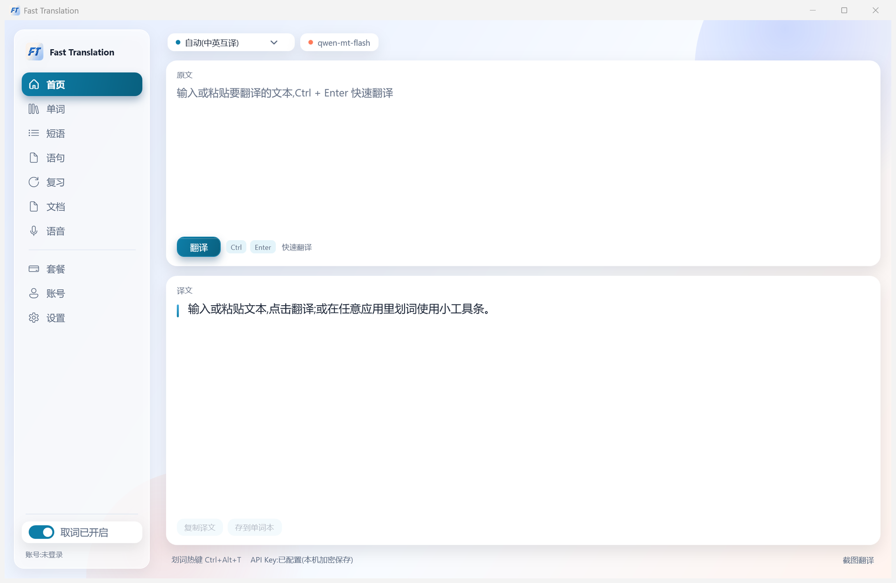
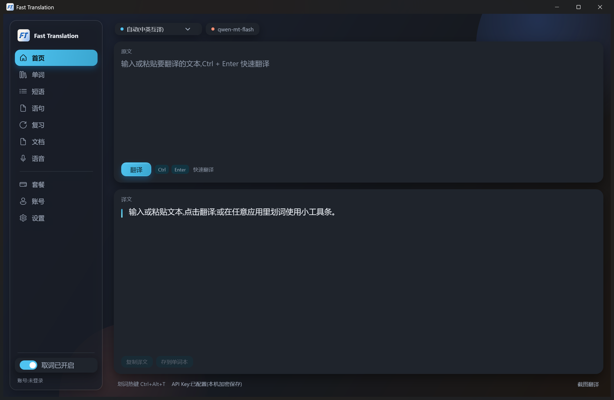

# Fast Translation

划词即翻译的 Windows 桌面工具。选中任意应用里的文字，浮出一条工具条，点「翻译」在原位读结果，点「替换」或「插入」把译文写回原处。

基于千问翻译模型（阿里云百炼 DashScope 的 `qwen-mt-flash`），你自己的 API Key 直连官方接口，不经过任何中间服务器。

<p align="center">
  
  
</p>

---

## 它做什么

- **划词取词**：用 UI Automation 读取选区的文字和屏幕矩形，Chromium 类应用（VSCode、Electron、浏览器）有 6 层节点探测 + 3 次重试的兜底
- **两段式交互**：选中文字先只弹工具条（复制 / 翻译），点了「翻译」才真正请求，不浪费额度
- **原位结果卡**：译文浮在原文附近，可以复制、替换原文、插入到原处、切换目标语言、重试、关掉
- **写回**：替换或插入前做三重校验（窗口句柄 + UIA RuntimeId + 归一化后的选区文本），任何一项对不上就降级成「已复制」并提示，绝不写错地方
- **剪贴板兜底**：UIA 拿不到文字时，临时占用剪贴板发 Ctrl+C 取词，取完把剪贴板所有格式原样恢复
- **托盘常驻**：关窗口不退出；托盘菜单翻译剪贴板、打开主窗口、设置、检查更新、退出
- **自动更新**：启动 30 秒后静默检查、之后每 6 小时一次，发现新版本一键下载安装并重启；下载有镜像回退和 SHA256 校验

## 环境要求

| 项 | 要求 |
|---|---|
| 系统 | Windows 10 1809 及以上 / Windows 11（x64） |
| 运行时 | 不需要，安装包自带 .NET 运行时（self-contained） |
| 账号 | 一个[阿里云百炼](https://bailian.console.aliyun.com/) API Key，首次启动时填入 |

## 安装

从 [Releases](../../releases) 下载 `FastTranslation-1.2.2-Setup.exe` 双击安装。安装向导里可以改安装位置，默认装到当前用户目录（`%LOCALAPPDATA%\Programs\FastTranslation`），不需要管理员权限；装过 1.0.x MSI 版的不必先卸载，安装程序会自动清掉旧版本。

喜欢绿色版就下 `FastTranslation-1.2.2-portable.zip`，解压即用。便携版没有安装目录，因此不会自动安装更新，只会提示去下载页取新版。

> **当前构建未签名。** Windows SmartScreen 会拦一次，点「更多信息」→「仍要运行」。安装包请只从本仓库 Releases 获取。

卸载：设置 → 应用 → 「Fast Translation」→ 卸载。配置和 API Key 不会被删除，需要手动清理 `%LOCALAPPDATA%\FastTranslation`。

## 首次使用

1. 启动后托盘出现图标，弹出设置窗口
2. 填入 API Key（用 DPAPI 加密后存在 `%LOCALAPPDATA%\FastTranslation\qwenmt-api-key.bin`）
3. 选目标语言（默认「自动」，中英互译时按原文语种自动决定方向）
4. 保存，然后随便在哪个应用里选一段文字试试

默认热键 `Ctrl+Alt+T` 可以对剪贴板内容直接翻译，也可以在设置里改。

## 隐私

- 待翻译文本只发往 `dashscope.aliyuncs.com`，也就是你自己 Key 对应的官方接口，没有其他任何出网请求，不含遥测、崩溃上报、使用统计
- 本地不落盘任何选中过的文本、剪贴板内容或按键记录；配置文件里只有语言、热键、开关、排除应用名这些设置项
- 剪贴板兜底取词期间会短暂占用剪贴板，取完立刻按原格式恢复
- 密码框不取词；终端类应用只取词、不写回

## 已知限制

- 只支持 Windows x64，没有 ARM64 构建
- Chromium 系应用首次划词偶尔需要重试，程序内部已做 3 次探测
- 终端（Windows Terminal / cmd / PowerShell / conhost）只取词不写回，这是硬拒绝
- 安装包未做代码签名，企业环境可能被策略拦截

## 从源码构建

需要 [.NET SDK 10.0](https://dotnet.microsoft.com/download)（预览版即可）和 Git。

```powershell
git clone <this-repo>
cd FastTranslation
dotnet build FastTranslation.slnx -c Release
dotnet test FastTranslation.slnx -c Release
```

跑起来：

```powershell
dotnet run --project src/FastTranslation.App
```

打安装包（需要 [Inno Setup 6](https://jrsoftware.org/isdl.php)，脚本在 `installer/FastTranslation.iss`）：

```powershell
dotnet publish src/FastTranslation.App -c Release -r win-x64 --self-contained true -o publish/ft-folder
& "$env:LOCALAPPDATA\Programs\Inno Setup 6\ISCC.exe" installer/FastTranslation.iss
powershell -File tools/qa/make-portable.ps1
```

## 项目结构

```
src/
  FastTranslation.Core/              领域模型、设置、语言目录、协调器（零 Win32 / WPF 引用）
  FastTranslation.Platform.Windows/  UIA 取词、写回、剪贴板、鼠标钩子、托盘、浮层窗口、主题调色板
  FastTranslation.Providers.QwenMt/  千问翻译 HTTP 客户端
  FastTranslation.App/               WPF 外壳：主窗口、设置、首次引导、App 启动
tests/
  FastTranslation.Core.Tests/              24 个测试
  FastTranslation.Platform.Windows.Tests/  48 个测试（热键解析、写回校验、UIA 行切片、ICO 解析、调色板）
  FastTranslation.Providers.QwenMt.Tests/   6 个测试（本地假 HTTP 服务）
tools/
  qa/        截图、内存浸泡、安装校验、E2E 联调等 PowerShell 脚本
  Probe*/    启动耗时与内存探针（历史决策依据）
docs/
  PLAN.md              技术决策 D1–D9 与实测数据
  IMPL.md              迭代史 v1–v29，每个版本解决了什么
  superpowers/specs/   设计规格
```

架构上有一条硬约束：**Core 不引用 Win32 也不引用 WPF**，所有平台能力走 `Interfaces.cs` 里的接口，因此 Core 的测试可以在任何机器上跑。

设计说明见 `docs/superpowers/specs/2026-10-22-fast-translation-design.md`，迭代踩坑记录见 `docs/IMPL.md`。

## 许可

[MIT](LICENSE)。第三方依赖与参考项目见 [THIRD_PARTY_NOTICES.md](THIRD_PARTY_NOTICES.md)。

本项目和阿里云、阿里巴巴集团没有隶属关系，是个人项目。
