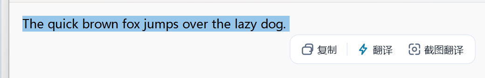
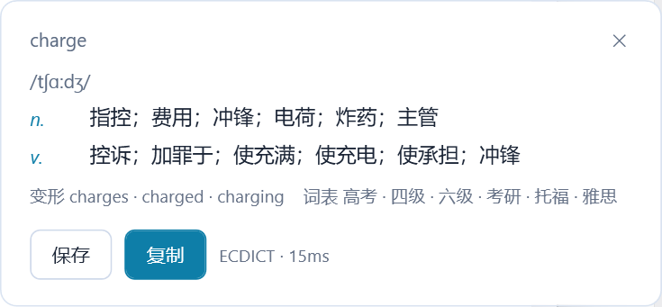
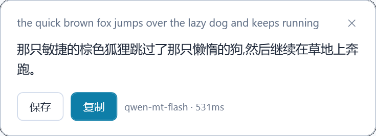
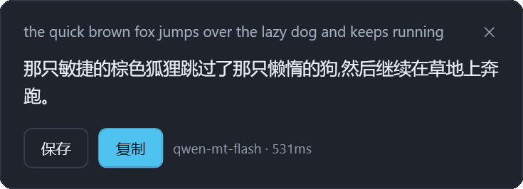
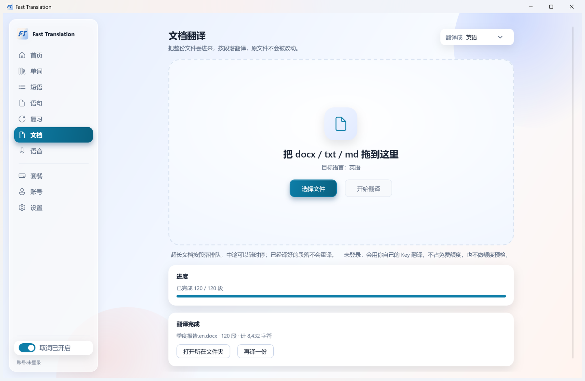
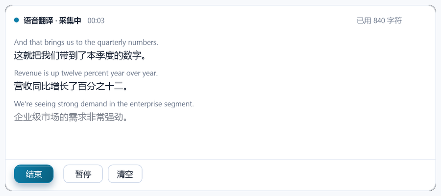
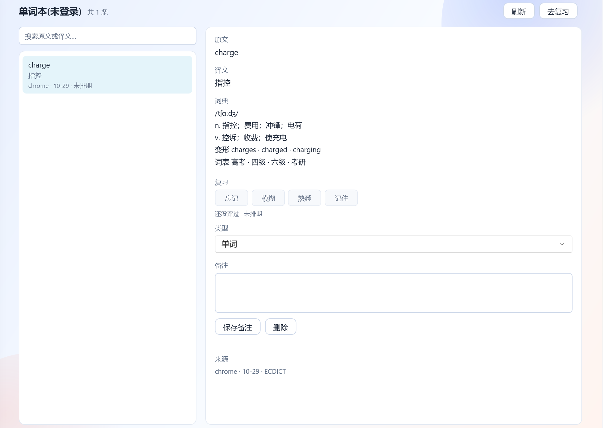
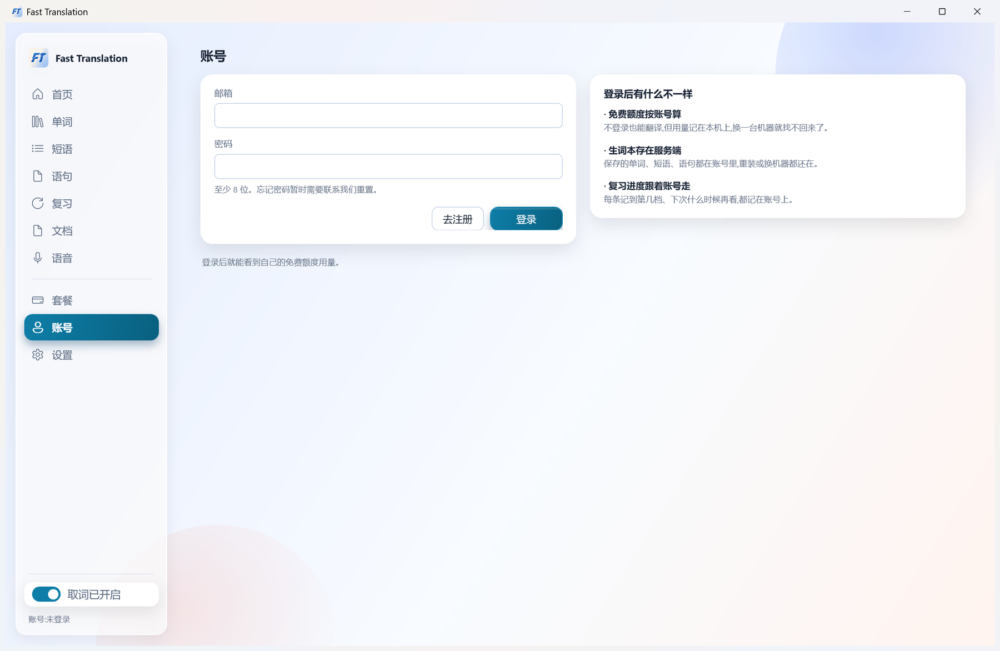
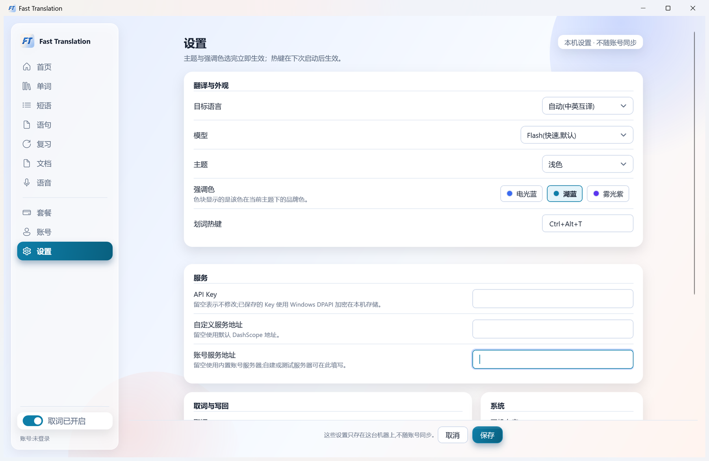
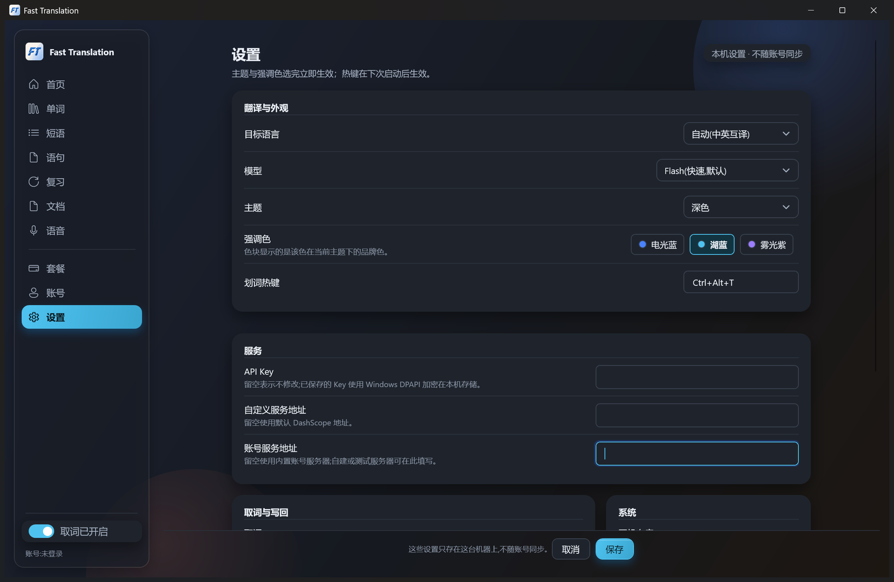

# Fast Translation

划词即翻译的 Windows 桌面工具。在任意应用里选中文字，浮出一个小工具条（复制 / 翻译 / 截图翻译），点「翻译」就在原文旁边读结果；译文可以复制、替换原文、插入到光标处，或存进单词本。除此之外还有整份文档翻译、系统声音的实时双语字幕，以及跟着账号走的单词本与四档间隔复习。

翻译走阿里云百炼 DashScope 的千问模型：文本 `qwen-mt-flash`（可选 `qwen-mt-lite` / `qwen-mt-plus`），截图翻译 `qwen-mt-image-2.0`，OCR `qwen-vl-ocr`，语音识别 `qwen-audio-3.1-asr-flash-streaming`。不登录也能一直用：填自己的 API Key 直连官方接口；登录账号后走免费 / 付费额度，请求由本项目的服务端转发并按字符记账，额度用完自动回落到你自己的 Key，翻译不会中断。

<p align="center">
  
  
</p>

> 当前版本 **1.5.1** · Windows 10 1903 及以上 / Windows 11（x64）· 安装包自带 .NET 运行时

## 功能

### 划词翻译

- **取词**：在任意应用里选中文字，工具条自动浮在选区旁边；取词走 UI Automation，沿父链最多探 6 层、失败重试 3 次，Chromium 系应用（VS Code、Electron、浏览器）也能取到。
- **两段式交互**：选中只弹工具条，点「翻译」才真正请求，不浪费额度。工具条上的第三颗按钮直接把当前选区交给截图翻译。
- **剪贴板兜底**：UIA 拿不到文字时，临时向目标窗口发 `Ctrl+C` 取词，取完立刻把剪贴板的全部格式原样恢复。
- **直接翻译**：按 `Ctrl+Alt+T` 跳过工具条，直接翻译当前选区；主窗口首页也能粘贴文本后按 `Ctrl+Enter` 翻译。
- **不打扰**：密码框不取词；终端类应用（Windows Terminal / cmd / PowerShell / conhost）只取词、不写回；设置里可以按进程名排除应用。

<p align="center">
  
</p>

#### 结果卡

结果卡浮在原文附近，显示原文片段、译文与状态行（模型、耗时、token 用量；额度回落到自己的 Key 时也会写明）。卡片上的操作：

| 按钮 | 行为 |
|---|---|
| 复制 | 把译文写入剪贴板 |
| 替换原文 | 用译文替换当前选区 |
| 插入译文 | 在光标处插入译文，不动原选区 |
| 保存 | 存进单词本（需要登录账号并开通单词本权限） |
| ✕ | 关闭结果卡 |

写回前会做三重校验：目标窗口句柄仍是取词时那个、锚点元素的 UIA RuntimeId 没变、归一化后的选区文本仍与捕获时一致。任何一项对不上就降级成「已复制」并提示，绝不写错地方。

选中**单个英文单词**时，卡片显示的是词典样式：音标、按词性分组的义项、词形变化与考试标签，数据来自随安装包分发的本地词库（ECDICT），离线查询、不消耗额度；句子和短语仍然走在线翻译。

<p align="center">
  
</p>

<p align="center">
  
  
</p>

### 截图翻译

- **入口**：`Ctrl+Alt+S`、划词工具条上的「截图翻译」、托盘菜单都可以发起。
- **框选**：屏幕变暗后按住左键拖一个框，松开即开始；`Esc` 或右键取消。
- **两条链路并行**：图片翻译（`qwen-mt-image-2.0`）生成译图，OCR（`qwen-vl-ocr`）识别原文；识别出的文字还会再翻一遍，所以译图以外还能拿到可编辑的原文与纯文本译文。
- **结果窗**：可以「复制图片」「另存为…」「保存到单词本」，识别到的原文可以直接修改后再保存。
- **不走图床**：截图以 base64 直接发给翻译接口，不需要公网地址，也不上传到任何第三方存储。
- **效果边界**：网页、宽界面、PPT 这类稀疏排版效果好；密集小字、多栏挤在一起的界面会错位，建议框小一点分开翻。

### 文档翻译

- **格式**：`.docx` / `.txt` / `.md`，拖进「文档」页或点「选择文件」，选好目标语言后开始。
- **不改原文件**：解析、拆段、回写全在本机完成，只有段落文字发往翻译接口；产物是 `原文件名.语言后缀.docx`（如 `季度报告.en.docx`），放在源文件旁边或你指定的目录，原文件一个字节都不动。
- **断点续译**：进度按段记录在本机；中途取消、断网或额度用完，再对同一份文件点一次开始会接着译，已经译好的段落不重译、不重复计费。
- **失败可补**：个别段落翻不成会保留原文并标上「【未翻译】」，完成后可以「重试未翻译的段」，不会重译其余部分。
- **格式保留**：段落级回写会保住字体、字号、颜色、段落样式、表格与页眉页脚；段落内部的局部加粗、超链接这类 run 级格式会被合并成一种。
- **上限**：单文件 ≤10 MB、可译字符 ≤20 万、段落 ≤5,000；`.xlsx` / `.pptx` / `.pdf` 尚未支持。

<p align="center">
  
</p>

### 语音翻译

- **入口**：`Ctrl+Alt+V`、托盘菜单「语音翻译」，或主窗口「语音」页点「开始语音翻译」。
- **采什么**：采集系统回环声音——电脑里正在播放的会议、网课、视频、通话，不占麦克风，也不需要选窗口。
- **字幕浮窗**：屏幕底部出现双语字幕，约一秒出稿；非终稿显示为灰色半透明，终稿落定后变实。浮窗可拖动，支持暂停 / 继续 / 清空 / 结束。
- **显示设置**：目标语言、是否显示原文、字幕条数（100 / 200 / 500）、语音热键都可以在语音页改，即时生效；切换播放设备会自动重连。
- **计费**：按秒计费，每秒折算 50 字符，每轮会话最少按 5 秒计费；开始前显示「今天 / 本月剩余可讲约 N 分钟」，剩余不足 30 秒会拒绝开始。语音翻译需要登录账号。
- **隐私**：音频经本项目的服务端转发给识别接口，服务端不保存音频；出网的还有识别出的文字。

<p align="center">
  
</p>

### 单词本与复习

- **收词**：翻译结果卡和截图翻译结果窗都能一键「保存」，按内容自动归类成单词 / 短语 / 语句；也可以手动改类型、写备注。
- **词典一起存**：从词典卡保存的单词，音标、词性、多义项、词形与考试标签会跟着存下来，单词本详情和复习页都能看到；词典功能之前保存的老词条，重新保存一次就会补齐。
- **跨设备**：词条存在服务端，重装或换电脑登录同一账号就能拿回来；免费版只读，保存与同步需要 Lite 及以上的付费档。
- **浏览**：左侧「单词 / 短语 / 语句」三栏按类型分页，支持按原文或译文搜索，右侧详情可改类型、写备注、直接评分或删除。
- **复习队列**：每天把到期卡排进来，另加最多 20 条当天新存的；新卡没学完会留在队列里，不会因为跨天消失。日界线按本机时区的零点算。
- **四档评分**：忘记 → 10 分钟后；模糊 → 1 天后；熟悉 → 3 天后；记住 → 7 天后，之后每次「记住」逐档升到 14 / 28 / 56 天。复习时按 `空格` 看译文，按 `1`–`4` 评分，`跳过` 不算评过。
- **键盘优先**：复习页不用鼠标也能走完一轮；评分按钮在答案揭晓前置灰，避免手快误点。

<p align="center">
  
</p>

### 账号、设备与额度

- **邮箱账号**：注册后即得每月 10,000 字符免费额度（每日 2,000）；登录后账号页显示本月 / 今日剩余。
- **两种额度可以混用**：登录后优先走服务端网关的免费 / 付费额度；额度用完自动静默回落到你自己的 API Key，翻译不中断，结果卡的状态行会注明这次用了哪个。
- **套餐**：付费套餐目前用激活码开通，在「套餐」页兑换后立刻生效；付款渠道尚未接通，页面上点「订阅」只会记录意向。
- **设备管理**：单账号最多 3 台设备。账号页的「登录设备」卡片会列出设备、上次登录时间与当前设备；不用的设备可以移除，名额立刻空出来。当前设备不能在这里移除。
- **自己的 Key**：不登录也能用，Key 用 Windows DPAPI 加密后存在 `%LOCALAPPDATA%\FastTranslation\qwenmt-api-key.bin`，直连 `dashscope.aliyuncs.com`。

<p align="center">
  
</p>

### 托盘、热键与自动更新

- **托盘常驻**：关掉主窗口只是收进托盘，划词服务继续工作；真正退出走托盘菜单「退出」。单实例运行，重复启动不会开出第二个进程。
- **托盘菜单**：设置、账号、单词本、暂停 / 恢复取词、检查更新、截图翻译、语音翻译、退出。
- **默认热键**：

  | 热键 | 作用 |
  |---|---|
  | `Ctrl+Alt+T` | 直接翻译当前选区 |
  | `Ctrl+Alt+S` | 截图翻译 |
  | `Ctrl+Alt+V` | 开始 / 结束语音翻译 |

  三个热键都能在设置里改；被别的程序占用时，托盘会提示换一个。
- **自动更新**：启动约 30 秒后静默检查一次，之后每 6 小时一次；发现新版本会提示下载、安装并重启。下载有镜像回退与 SHA256 校验。只有通过安装包装出来的副本才会自更新；便携版只提示去下载页取新版。

### 外观与设置

- **十个侧栏页面**：首页、单词、短语、语句、复习、文档、语音、套餐、账号、设置。
- **主题**：跟随系统 / 浅色 / 深色；强调色有电光蓝、湖蓝、雾光紫三支，选完立即生效，不用重启。
- **翻译选项**：目标语言（默认「自动」，中英互译时按原文语种决定方向）、模型 Lite / Flash / Plus（Lite 按 0.85 倍、Plus 按 2.7 倍消耗额度）、划词热键。
- **取词与写回**：剪贴板兜底开关、是否允许替换原文、按进程名排除应用、开机自启。
- **服务地址**：自定义 DashScope 地址与账号服务地址，留空就用默认值；自建或测试服务器可以填在这里。
- **只存本机**：主题、热键、Key、服务地址等设置都存在本机 `settings.json`，不随账号同步。

<p align="center">
  
  
</p>

## 环境要求

| 项 | 要求 |
|---|---|
| 系统 | Windows 10 1903 及以上 / Windows 11（x64） |
| 运行时 | 不需要，安装包自带 .NET 运行时（self-contained） |
| 账号 | 可选：注册账号领免费额度，或自备一个[阿里云百炼](https://bailian.console.aliyun.com/) API Key |

## 安装

从 [Releases](../../releases) 下载 `FastTranslation-1.5.1-Setup.exe` 双击安装。安装向导里可以改安装位置，默认装到当前用户目录（`%LOCALAPPDATA%\Programs\FastTranslation`），不需要管理员权限；装过 1.0.x MSI 版的不必先卸载，安装程序会自动清掉旧版本。

喜欢绿色版就下 `FastTranslation-1.5.1-portable.zip`，解压即用。便携版没有安装目录，因此不会自动安装更新，只会提示去下载页取新版。

> **当前构建未签名。** Windows SmartScreen 会拦一次，点「更多信息」→「仍要运行」。安装包请只从本仓库 Releases 获取。

卸载：设置 → 应用 → 「Fast Translation」→ 卸载。配置和 API Key 不会被删除，需要手动清理 `%LOCALAPPDATA%\FastTranslation`。

## 首次使用

1. 启动后托盘出现图标，弹出设置窗口
2. 选一种翻译额度，两种可以混用：
   - **注册账号**：在「账号」页用邮箱注册，免费额度到手就能翻，不用自己申请 API Key
   - **自己的 Key**：在设置里填入 API Key（用 DPAPI 加密后存在本机），直连 DashScope
3. 选目标语言（默认「自动」，中英互译时按原文语种自动决定方向）
4. 保存，然后随便在哪个应用里选一段文字试试

默认热键：`Ctrl+Alt+T` 直接翻译选区、`Ctrl+Alt+S` 截图翻译、`Ctrl+Alt+V` 语音翻译，都可以在设置里改。

## 隐私

- 没有遥测、崩溃上报、使用统计，不写任何文本日志
- **用自己的 Key 时**：待翻译文本只发往 `dashscope.aliyuncs.com`，直连官方接口
- **用账号额度时**：待翻译文本发往本项目的服务端，由它转发给 DashScope；服务器只按字符记账，不保存划词与译文
- 语音翻译：音频会经本项目的服务端转发给识别接口，服务端不保存音频；出网的还有识别出的文字
- 单词本里你主动保存的词条存在服务端（用于跨设备同步与复习）；除此之外本地不落盘任何选中过的文本、剪贴板内容或按键记录
- 账号页可以重置密码或注销账号；注销会永久删除账号与全部学习记录，不可恢复
- 遇到账号或数据问题，发邮件到 `3349325206@qq.com`
- 剪贴板兜底取词期间会短暂占用剪贴板，取完立刻按原格式恢复
- 密码框不取词；终端类应用只取词、不写回

## 已知限制

- 只支持 Windows x64，没有 ARM64 构建
- Chromium 系应用首次划词偶尔需要重试，程序内部已做 3 次探测
- 终端（Windows Terminal / cmd / PowerShell / conhost）只取词不写回，这是硬拒绝
- 安装包未做代码签名，企业环境可能被策略拦截
- 单词本免费版只读，保存词条需要 Lite 及以上付费档的订阅
- 语音翻译的源语言由识别结果决定，自动档按中英互译配对；需要登录账号并按秒消耗额度（剩余不足 1 分钟拒绝开始）
- 文档翻译只支持 `.docx` / `.txt` / `.md`，单文件 ≤10 MB、可译字符 ≤20 万、段落 ≤5,000；`.xlsx` / `.pptx` / `.pdf` 尚未支持。段落级回写会保留字体、字号、颜色与段落样式，但段落内部的局部加粗 / 超链接等 run 级格式会被合并成一种
- 截图翻译在密集小字、多栏排版上会错位，建议缩小选区分开翻

## 从源码构建

需要 [.NET SDK 10.0](https://dotnet.microsoft.com/download)（预览版即可）和 Git。

```powershell
git clone <this-repo>
cd FTranslation
dotnet build FastTranslation.slnx -c Release
dotnet test FastTranslation.slnx -c Release
```

跑起来：

```powershell
dotnet run --project src/FastTranslation.App
```

本地起服务端（可选，账号、单词本与额度网关的联调用）：

```powershell
dotnet run --project server/FastTranslation.Server
```

打安装包（需要 [Inno Setup 6](https://jrsoftware.org/isdl.php)，脚本在 `installer/FastTranslation.iss`）：

```powershell
dotnet publish src/FastTranslation.App -c Release -r win-x64 --self-contained true -o publish/ft-folder
& "$env:LOCALAPPDATA\Programs\Inno Setup 6\ISCC.exe" installer/FastTranslation.iss
powershell -File tools/qa/make-portable.ps1
```

## 项目结构

```
src/
  FastTranslation.Core/              领域模型、设置、语言目录、协调器（零 Win32 / WPF 引用）
  FastTranslation.Platform.Windows/  UIA 取词、写回、剪贴板、鼠标钩子、托盘、浮层窗口、更新安装器、主题调色板
  FastTranslation.Providers.QwenMt/  千问翻译 HTTP 客户端（文本 / 图片 / OCR，直连与自建网关两套）
  FastTranslation.App/               WPF 外壳：主窗口十个页面、截图翻译、语音会话、自动更新
server/
  FastTranslation.Server/            ASP.NET Core minimal API：账号、设备、单词本、额度与订阅闸门、开发者网关、语音中继（SQLite）
site/                                产品介绍静态单页（纯 HTML/CSS，无构建步骤）
admin/                               运营后台静态单页（纯 HTML/CSS/JS，无构建步骤）
deploy/                              一台 ECS 的部署文件（systemd + Caddy）
tests/
  FastTranslation.Core.Tests/              441 个测试（设置、复习调度、文档拆段、额度、语音口径、本地词库）
  FastTranslation.Platform.Windows.Tests/  109 个测试（热键解析、写回校验、UIA 行切片、ICO 解析、调色板）
  FastTranslation.Providers.QwenMt.Tests/  101 个测试（本地假 HTTP 服务）
  FastTranslation.Server.Tests/            310 个测试（WebApplicationFactory 起真服务 + 临时 SQLite）
tools/
  qa/        截图、内存浸泡、安装校验、E2E 联调等 PowerShell 脚本
  Probe*/    启动耗时与内存探针（历史决策依据）
docs/
  PLAN.md              技术决策 D1–D9 与实测数据
  IMPL.md              实现记录索引（分册在 docs/impl/，每 20 个版本一册）
  superpowers/specs/   设计规格
```

全部 961 个测试，`dotnet test` 全绿是交付门（本仓库没有 CI，结果以本机输出为准）。

架构上有一条硬约束：**Core 不引用 Win32 也不引用 WPF**，所有平台能力走 `Interfaces.cs` 里的接口，因此 Core 的测试可以在任何机器上跑。

设计说明见 `docs/superpowers/specs/2026-10-22-fast-translation-design.md`，迭代踩坑记录见 [`docs/IMPL.md`](docs/IMPL.md)。

## 许可

[GNU AGPL v3.0](LICENSE)（GNU Affero General Public License v3.0）。Copyright (C) 2026 FastTranslation Project。

AGPL 是强 copyleft：如果你修改本项目并把它作为网络服务提供给别的用户，需要按第 13 条把对应的完整源码也提供给那些用户；只是自己用、或原样分发二进制，不受额外影响。第三方依赖与参考项目见 [THIRD_PARTY_NOTICES.md](THIRD_PARTY_NOTICES.md)。

本项目和阿里云、阿里巴巴集团没有隶属关系，是个人项目。
